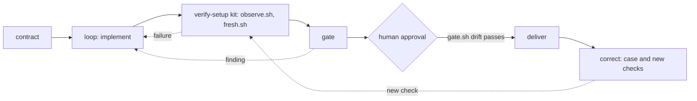

# Agentic Engineering, Applied

**Evidence-driven methods, dogfooded on real engineering work.**

These skills turn real engineering work into portable agent protocols. They favor retrievable evidence over confident prose and keep public methods agnostic across repositories, stacks, editors, and agents.

## The core

Five skills. Every change follows the same path, and every step ends on command output, never on a claim.



### Contract

[Contract](skills/.experimental/contract) writes the done criteria before code changes: intent, size class (`trivial`, `normal`, `heavy`), and acceptance and must-not-change items each mapped to a verify driver. `fresh.sh` refuses done until every named feature is observed.

### Loop

[Loop](skills/.experimental/loop) runs one change from contract to a reviewed, observed, human-approved state. Ceremony scales with the size class; heavy work compares shapes with the human first and observes before and after.

### Verify Setup

[Verify Setup](skills/.experimental/verify-setup) gives a repository an executable verification kit under `.agents/verify`: doctor, checks, per-feature drivers that keep evidence tied to the exact tree, and `fresh.sh` for a Stop hook. `--local` keeps the kit out of git.

### Gate

[Gate](skills/gate) gates one exact diff: deterministic checks including `gate.sh verify` and `gate.sh drift`, then only the lenses the change triggers. Its deep lenses (test strength, resilience, security, simplify) live in `references/lenses/`.

### Correct

[Correct](skills/correct) closes the work: it records the evidence ledger, then turns each escaped mistake into a check that fails on it, proven against the original mistake, recorded in the repo's enforcer table and the case `Enforcer` field.

Everything else lives in [archive/](archive/README.md).

## Maturity

Distribution channel and evidence maturity are separate. Stable contains Gate and Correct. Experimental skills remain installable without implying validation.

The source of truth is [foundry/maturity.json](foundry/maturity.json).

| State | Meaning |
|---|---|
| experimental | Coherent method and trigger boundary, without real-work use |
| dogfooded | Used on real work, without a reliable baseline comparison |
| evaluated | Compared against a baseline, but evidence remains incomplete or inconclusive |
| validated | Repeatable positive effect across holdouts and trials, with human review |
| deprecated | Retained for provenance but no longer recommended |

## Install

Install interactively into supported agents:

```bash
bunx skills add Railly/skills
```

The interactive installer exposes two groups: `Stable` and `Experimental`. Install only the stable surface with:

```bash
bunx skills add Railly/skills --skill correct --skill gate
```

Install the whole core with:

```bash
bunx skills add Railly/skills --all
```

Or clone and link one skill:

```bash
git clone https://github.com/Railly/skills.git ~/railly-skills
ln -s ~/railly-skills/skills/gate ~/.claude/skills/gate
```

For Codex, Cursor, and other compatible agents, install or link the same folder under the corresponding project or personal skills directory.

Development installs should be symlinks to the canonical checkout. Diagnose a linked, exact-copy, diverged, or missing install with:

```bash
bun scripts/skills-doctor.mjs --installed ~/.agents/skills
```

The doctor also compares each canonical package against the declared Git revision. A linked install backed by uncommitted package changes reports `source=dirty` and fails until the source can be tied to a revision. A stable Gate pass records the executing skill revision and refuses an unresolved, diverged, or dirty identity.

Preview a reversible development-link migration, then apply it only from a clean canonical package revision:

```bash
bun scripts/link-skills.mjs --installed ~/.agents/skills
bun scripts/link-skills.mjs --installed ~/.agents/skills --apply
```

Every replaced directory is moved to the printed backup root before its relative symlink is created. The operation preflights every selected package and rolls back links already changed if a later operation fails.
Pass `--source <repository>` when the migration command is running from a separate tools checkout.

## Repository structure

```text
skills/                 stable skills (gate, correct)
skills/.experimental/   experimental skills (contract, loop, verify-setup)
cases/                  evidence ledgers written by correct, plus per-repo conventions read by gate
foundry/                maturity registry and the rounds that decided it
scripts/                validation and eval machinery
archive/                everything retired: old skills, cases, foundry, knowledge layer, scripts, subagents, notes
```

Installed copies under `.agents/skills`, `.claude/skills`, or another agent directory are read-only; cases, run reports, and rounds are written here.

## Validate

```bash
bun scripts/validate-skills.mjs
bun test scripts/lib/*.test.mjs
bunx @crafter/skillkit@0.13.0 audit skills --json --strict
```

CI checks frontmatter, size, internal links, maturity metadata, case fields including `Enforcer`, eval metadata, and the gate scripts.

## License

MIT (c) Railly Hugo
