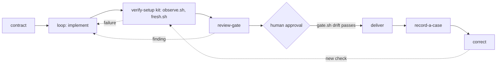

# Agentic Engineering, Applied

**Evidence-driven methods, dogfooded on real engineering work.**

These skills turn real engineering work into portable agent protocols. They favor retrievable evidence over confident prose and keep public methods agnostic across repositories, stacks, editors, and agents.

## The core

Six skills. Every change follows the same path, and every step ends on command output, never on a claim.



### Contract

[Contract](skills/.experimental/contract) writes the done criteria before code changes: intent, size class (`trivial`, `normal`, `heavy`), and acceptance and must-not-change items each mapped to a verify driver. `fresh.sh` refuses done until every named feature is observed.

### Loop

[Loop](skills/.experimental/loop) runs one change from contract to a reviewed, observed, human-approved state. Ceremony scales with the size class; heavy work compares shapes with the human first and observes before and after.

### Verify Setup

[Verify Setup](skills/.experimental/verify-setup) gives a repository an executable verification kit under `.agents/verify`: doctor, checks, per-feature drivers that keep evidence tied to the exact tree, and `fresh.sh` for a Stop hook. `--local` keeps the kit out of git.

### Review Gate

[Review Gate](skills/review-gate) gates one exact diff: deterministic checks including `gate.sh verify` and `gate.sh drift`, then only the lenses the change triggers. Its deep lenses (test strength, resilience, security, simplify) live in `references/lenses/`.

### Record a Case

[Record a Case](skills/record-a-case) captures finished or interrupted work as an evidence ledger, with one compiled-knowledge disposition and an `Enforcer` field.

### Correct

[Correct](skills/.experimental/correct) turns one escaped mistake into a check that fails on it, proves it fails on the original mistake and passes on the fix, and records it in the repo's enforcer table and the case.

Everything else lives in [archive/](archive/README.md).

## Maturity

Distribution channel and evidence maturity are separate. Stable contains Review Gate and Record a Case. Experimental skills remain installable without implying validation.

The source of truth is [foundry/maturity.json](foundry/maturity.json).

| State | Meaning |
|---|---|
| experimental | Coherent method and trigger boundary, without real-work use |
| dogfooded | Used on real work, without a reliable baseline comparison |
| evaluated | Compared against a baseline, but evidence remains incomplete or inconclusive |
| validated | Repeatable positive effect across holdouts and trials, with human review |
| deprecated | Retained for provenance but no longer recommended |

## Install

Install interactively into supported agents:

```bash
bunx skills add Railly/skills
```

The interactive installer exposes two groups: `Stable` and `Experimental`. Install only the stable surface with:

```bash
bunx skills add Railly/skills --skill record-a-case --skill review-gate
```

Install the whole core with:

```bash
bunx skills add Railly/skills --all
```

Or clone and link one skill:

```bash
git clone https://github.com/Railly/skills.git ~/railly-skills
ln -s ~/railly-skills/skills/review-gate ~/.claude/skills/review-gate
```

For Codex, Cursor, and other compatible agents, install or link the same folder under the corresponding project or personal skills directory.

Development installs should be symlinks to the canonical checkout. Diagnose a linked, exact-copy, diverged, or missing install with:

```bash
bun scripts/skills-doctor.mjs --installed ~/.agents/skills
```

The doctor also compares each canonical package against the declared Git revision. A linked install backed by uncommitted package changes reports `source=dirty` and fails until the source can be tied to a revision. A stable Review Gate pass records the executing skill revision and refuses an unresolved, diverged, or dirty identity.

Preview a reversible development-link migration, then apply it only from a clean canonical package revision:

```bash
bun scripts/link-skills.mjs --installed ~/.agents/skills
bun scripts/link-skills.mjs --installed ~/.agents/skills --apply
```

Every replaced directory is moved to the printed backup root before its relative symlink is created. The operation preflights every selected package and rolls back links already changed if a later operation fails.
Pass `--source <repository>` when the migration command is running from a separate tools checkout.

## Repository structure

```text
skills/                 stable installable surface
skills/.experimental/   candidate and experimental installable surfaces
cases/                  public-safe evidence ledger
foundry/                governance, lessons, eval rounds, live runs, and decisions
scripts/                deterministic validation and eval machinery
```

Stable skills stay flat. Candidate and Experimental skills use the standard `skills/.experimental/` catalog recognized by the skills CLI. The maturity registry assigns their distribution channel, and the plugin manifest supplies the visible `Stable`, `Candidates`, and `Experimental` installer groups.

All cases, evals, run reports, decision trails, and Foundry logs follow the [canonical source repository policy](foundry/source-of-truth.md). Installed copies under `.agents/skills`, `.claude/skills`, or another agent directory are read-only distribution surfaces.

## Skill foundry

Real work becomes a case before it becomes an instruction:

```text
maintenance work
→ case
→ candidate lesson
→ bounded proposal packet
→ baseline comparison
→ human review
→ promote, absorb, or reject
```

Build a one-skill proposal packet and record a reviewed outcome with:

```bash
bun scripts/build-proposal-packet.mjs record-a-case --output foundry/runs/proposal-impact/<run>/packet.json
bun scripts/record-impact.mjs foundry/runs/proposal-impact/<run>/impact-record.json
```

Rejected candidates remain queryable in the compiled graph and cannot change the active skill digest. Accepted candidates require passing eval evidence and explicit human authority.

Every supported agent use can also produce a private Skillkit receipt. Routine usage remains telemetry. Reviewed failures, corrections, interruptions, novel transfers, and maintainer feedback can be compiled into sanitized candidates with:

```bash
skillkit receipts --all --json > /private/path/receipts.json
bun scripts/compile-usage-receipts.mjs /private/path/receipts.json
```

The compiler copies no transcript, local path, session ID, or private summary. It creates no canonical case and changes no skill automatically.

For a closed work-item manifest, generate reviewed annotations and apply them locally only after inspecting the JSON:

```bash
bun scripts/work-item.mjs annotations /private/path/work-item.manifest.json --output /private/path/annotations.json
skillkit receipts --annotate /private/path/annotations.json
```

Remote annotation is intentionally unsupported. Apply annotations on the machine that owns the SkillKit receipt database.

Read the [product direction](NORTH.md), [foundry overview](foundry), [compiled knowledge](foundry/knowledge), [governance](foundry/governance.md), [source repository policy](foundry/source-of-truth.md), [Issue Contract workflow](foundry/missions), [eval protocol](foundry/eval-protocol.md), and [case template](foundry/case-template.md). Deprecated methods and the archived Unfold protocol remain under [foundry/deprecated](foundry/deprecated).

Public issues and pull requests may become public cases. Confidential evidence stays in an organization-approved private system; only generalized, sanitized lessons cross into this repository.

## Validate

```bash
bun scripts/validate-skills.mjs
bun scripts/validate-issue-contracts.mjs
bun scripts/validate-knowledge.mjs
bun scripts/compile-knowledge.mjs --check
bun scripts/audit-knowledge-matches.mjs --check
bun scripts/verify-eval-fixtures.mjs
bunx @crafter/skillkit@0.13.0 audit skills --json --strict
```

CI checks frontmatter, progressive disclosure, internal links, maturity metadata, public-case boundaries, Issue Contracts, compiled knowledge, eval metadata, and executable fixtures. Strict knowledge maturity enforcement joins CI after the four unsupported non-experimental skills gain prospective application evidence or their maturity changes.

## License

MIT (c) Railly Hugo
